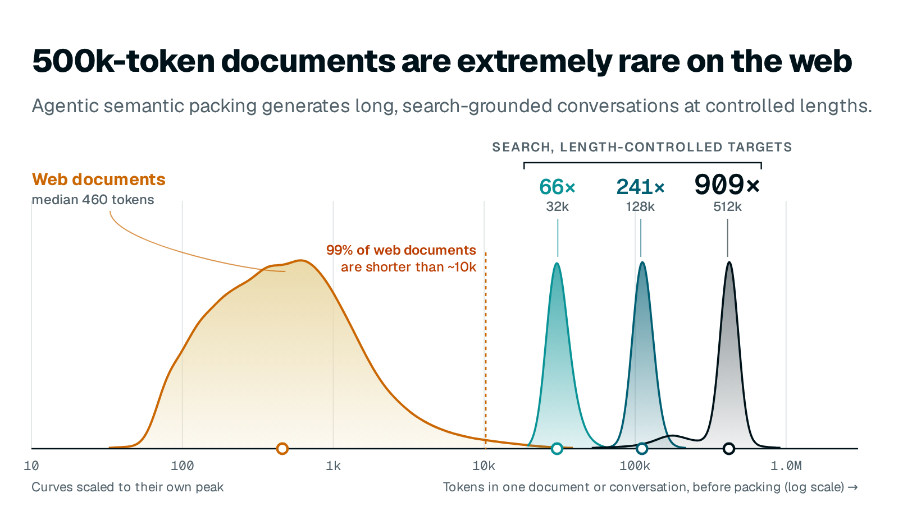

# Agentic Semantic Packing



Length-controlled, search-grounded conversations with tool calls. This is one script, `generate.py`, that turns a seed question into a long, multi-turn research conversation of a target length. The conversation includes tool calls and is grounded in a document corpus.

## How it works

1. A simulated user asks the seed question. The user has a random persona (role × style × trait × approach, 1296 combinations).
2. The agent makes a burst of `search` / `get_document` calls against a [search360](https://github.com/ifm-ai/search360) server. It writes analysis alongside every call.
3. After each burst, the agent replies to the user. The simulated user then asks a follow-up that pushes into territory not yet covered.
4. Steps 2 and 3 repeat until the conversation reaches `STOP_FRACTION × target_tokens`. The agent then writes a final answer.

Length is counted with tiktoken `cl100k_base` over message content, reasoning (`think`) and tool calls. Length control is soft: research stops at 80% of the target, and the final answer adds the rest. Long tool results can overshoot the target.

## Diversity knobs

The knobs are constants at the top of `generate.py`.

| Knob | Default | Effect |
|---|---|---|
| `PERSONA_AXES` | 6 roles × 6 styles × 6 traits × 6 approaches | Who the user is. Changes the agent's system prompt and the tone of the follow-ups. |
| `OPENING_TEMPLATES` | 8 templates | How the seed question is phrased. |
| `FOLLOW_UP_TYPES` | react / drill deeper / redirect / challenge / clarify | The flavor of each simulated follow-up. |
| `FINAL_ANSWER_TEMPLATES` | 5 framings | Shape of the final answer: synthesis, verdict, narrative, balanced view, bottom line. |
| `BURST_SIZES` | `[4, 5, 6, 8]` | Tool calls between user turns. |
| `QUERY_SIMILARITY` | 0.85 | Rejects near-duplicate searches; re-reading a document is also blocked. |
| `AGENT_TEMPERATURE` / `USER_TEMPERATURE` | 0.7 / 0.8 | Sampling temperature for the agent and the simulated user. |
| `STOP_FRACTION`, `--target_tokens` | 0.8, 32k | Length control. |

## Usage

1. Start a [search360](https://github.com/ifm-ai/search360) server (`POST /search`, `POST /get_document`). The corpus and index are not distributed: build an index over your own corpus with search360's indexing scripts. Its default retriever (Contriever) has CC BY-NC weights.
2. Serve a model with tool calling through any OpenAI-compatible endpoint. For example, with vLLM:

   ```bash
   vllm serve deepseek-ai/DeepSeek-V3.1 --tensor-parallel-size 8 --port 8001 \
       --enable-auto-tool-choice --tool-call-parser deepseek_v31 --reasoning-parser deepseek_v3
   ```

3. Generate:

   ```bash
   uv run generate.py \
       --search_url http://localhost:8000 \
       --llm_base_url http://localhost:8001/v1 \
       --model deepseek-ai/DeepSeek-V3.1 \
       --questions_file seed_questions.jsonl \
       --output trajectories.jsonl
   ```

   - Use `--question "..." --target_tokens 64000` to run a single question.
   - `--max_context_tokens` caps the window sent to the model; the saved conversation is never truncated. Keep it below the served context length.

Each output line has the form `{uuid, conversation, metadata}`:

- The system turn carries the tool schemas.
- Assistant turns may have `think` and `tool_calls: [{name, arguments}]`.
- `metadata` records the target and achieved token counts, the search and document-read counts, and the persona.

## Samples

`samples/` holds 10 example conversations, from 26k to 120k tokens, and `seed_questions.jsonl` holds their seed questions and targets.

- Samples 1–5 were generated with a 32k target and samples 6–10 with a 128k target.
- They come from the fuller internal version of this pipeline. `generate.py` is a simplified reference that produces conversations of the same shape, not identical ones. The full version differed in these ways:
  - Follow-up types were chosen by rules: redirect on a stall or failed search, drill deeper when few documents had been read, otherwise "continue" or "build upon".
  - Each persona axis added a multi-line block to the system prompt, and opening templates were keyed by role and style.
  - It had retries for empty analysis and for final answers that contained tool calls, along with fallback replies and more pushback templates.
- The corpus behind the tool results is the search360 index.
- In the samples, `trace_tokens` is the tiktoken count and `token_count*` is the count under our training tokenizer.

## License

Code and samples are released under Apache-2.0 (see `LICENSE`).
